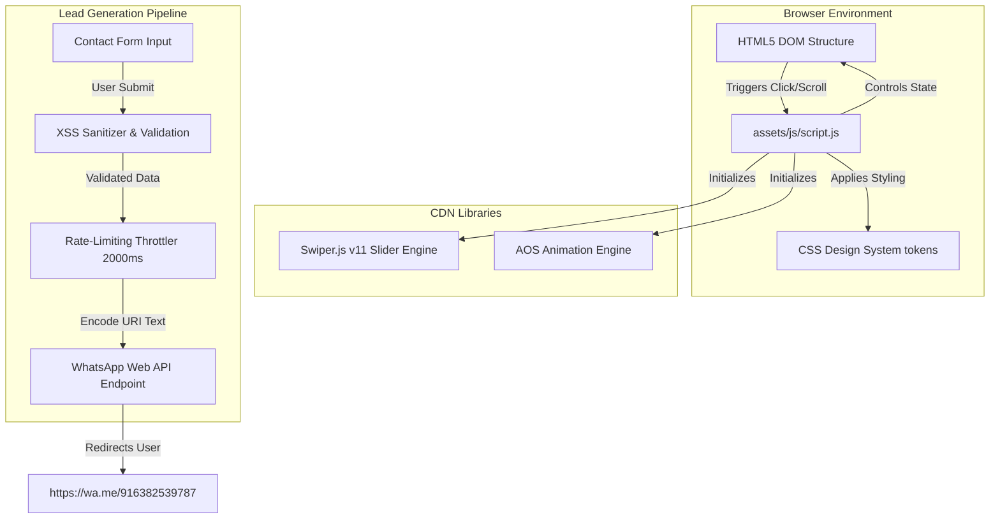

# CB BUILDERS — Architecture & Construction Company Website

[](LICENSE)
[](https://developer.mozilla.org/en-US/docs/Web/HTML)
[](https://developer.mozilla.org/en-US/docs/Web/CSS)
[](https://developer.mozilla.org/en-US/docs/Web/JavaScript)
[](https://swiperjs.com/)
[](https://michalsnik.github.io/aos/)
[](https://github.com/thronmuthu18/CB-builders)

An engineering-grade, responsive, accessible, and performant web platform for **CB BUILDERS**, a premier Architecture & Construction firm based in Tirunelveli, Tamil Nadu. The platform showcases turnkey residential construction, luxury interior design, commercial developments, false ceiling models, modular kitchens, painting works, and architectural elevation projects.

---

## 📋 Table of Contents

- [Overview](#-overview)
- [Key Features](#-key-features)
- [Tech Stack & Dependencies](#-tech-stack--dependencies)
- [Architecture & Data Flow](#-architecture--data-flow)
- [Project Directory Structure](#-project-directory-structure)
- [Getting Started & Installation](#-getting-started--installation)
- [Environment Configuration](#-environment-configuration)
- [Interactive System Components](#-interactive-system-components)
- [Security & Performance Hardening](#-security--performance-hardening)
- [Tested Responsive Viewports](#-tested-responsive-viewports)
- [License](#-license)
- [Contact & Support](#-contact--support)

---

## 🌟 Overview

**CB BUILDERS** combines structural engineering excellence with contemporary architectural aesthetics. This website functions as the primary digital portfolio and customer acquisition channel for the business, offering:

- **Turnkey Residential & Commercial Showcases**: Detailed portfolio grids categorized into 9 architectural disciplines.
- **Direct WhatsApp Lead Conversion**: Seamless client enquiry redirection with input sanitization and anti-spam throttling.
- **Cross-Device Performance**: Pixel-perfect rendering across mobile, tablet, and desktop viewports with zero horizontal scrolling.
- **Scalable Brand System**: Scalable Vector Graphics (SVG) logo system, custom color palette tokens, and typography system.

---

## ✨ Key Features

### 1. Full-Width Architectural Hero Slider
- **3 Real Project Slides**: Showcases real CB BUILDERS elevation and interior photography.
- **Tuned Ambient Overlay**: Multi-stop linear gradient (`rgba(15, 23, 42, 0.40)`) for visual clarity and text readability.
- **Glassmorphism Controls**: Smooth crossfade transitions with Swiper.js, pagination indicators (`● ○ ○`), and accessible navigation arrows.
- **Preload Optimization**: Instant initial paint via `<link rel="preload">` head tags.

### 2. Multi-Category Portfolio Gallery
- **9 Filtering Categories**: `All`, `Portico & Tiles`, `Steps`, `Painting`, `Elevation`, `Model Ceiling`, `Model Kitchen`, `Interior`, `Bedroom`.
- **Dynamic Pagination**: Progressive item rendering (8 project cards per load) via an optimized `loadMoreBtn` handler.
- **Standardized Aspect Ratios**: Uniform `4/3` aspect ratio grids preventing layout shifts (`CLS`).

### 3. Lightbox Image Zoom Preview
- Fullscreen modal preview with backdrop blur filtering (`backdrop-filter: blur(8px)`).
- Touch and keyboard controls (Press `Escape` to close modal).

### 4. Secure WhatsApp Lead Generation System
- Real-time client-side form validation (Email regex, Phone regex, Required field checks).
- XSS Input Sanitization (`sanitizeInput()`) escaping HTML entities (`&`, `<`, `>`, `"`, `'`).
- Anti-spam rate-limiting preventing duplicate message dispatches within 2000ms.
- Direct API formatting dispatching custom URL-encoded WhatsApp messages to `+91 63825 39787`.

### 5. Accessible Sticky Navigation & Mobile Menu
- Sticky top header with scroll-activated elevation drop shadows.
- ARIA-compliant mobile hamburger drawer (`aria-expanded`, `aria-controls`, `aria-label`).
- Touch-friendly click-outside backdrop dismissal.

---

## 🛠️ Tech Stack & Dependencies

| Category | Technology | Usage / Purpose |
| :--- | :--- | :--- |
| **Frontend Core** | HTML5, CSS3, ES6+ JavaScript | Semantic document layout, custom CSS properties, DOM event handling |
| **Styling Framework** | Vanilla CSS (BEM & CSS Variables) | Modular design tokens (`--primary-color`, `--accent-color`, `--shadow-md`) |
| **Slider / Carousel** | Swiper.js v11 | Touch-enabled hero carousel & client testimonials slider |
| **Scroll Animations** | AOS.js (Animate On Scroll) | Micro-interactions and section reveal animations |
| **Iconography** | Font Awesome 6.4.0 | UI icons (location, phone, email, WhatsApp, stars) |
| **Typography** | Google Fonts | Primary serif: `Playfair Display` \| Secondary sans-serif: `Inter` |
| **Branding Assets** | Vector SVG & PNG Fallback | `cb-builders-logo.svg`, `cb-builders-icon.svg`, `favicon.svg` |
| **Tooling / Server** | Node.js (`serve`, `http-server`) | Local development servers and static asset delivery |

---

## 🏗️ Architecture & Data Flow

The application follows a client-side architecture with DOM event handlers, dynamic asset filtering, and external integration with the WhatsApp Web API.



---

## 📁 Project Directory Structure

```text
CB_BUILDERS_COMPLETE_PROJECT/
├── assets/
│   ├── branding/
│   │   ├── cb-builders-logo.svg        # Primary SVG Brand Logo
│   │   ├── cb-builders-logo.png        # High-Resolution PNG Logo Fallback
│   │   ├── cb-builders-icon.svg        # SVG Icon Emblem
│   │   └── favicon.svg                 # SVG Favicon Asset
│   ├── css/
│   │   └── styles.css                  # Production CSS Design Tokens & Layout Rules
│   ├── js/
│   │   └── script.js                   # Modular JS Engine & Security Logic
│   └── images/
│       ├── about/                      # About section imagery (cb-builders-about-company.jpg)
│       ├── hero/                       # Hero slider background photos (hero-slide-01..03.jpg)
│       ├── projects/                   # Portfolio category asset directories
│       │   ├── bedroom/                # bedroom-design-01.jpg .. 30.jpg
│       │   ├── ceiling/                # ceiling-design-01.jpg .. 45.jpg
│       │   ├── cupboards/              # cupboard-design-01.jpg .. 23.jpg
│       │   ├── doors/                  # door-work-01.jpg .. 30.jpg
│       │   ├── elevation/              # elevation-project-01.jpg .. 54.jpg
│       │   ├── interior/               # interior-design-01.jpg .. 33.jpg
│       │   ├── kitchen/                # kitchen-design-01.jpg .. 24.jpg
│       │   ├── painting/               # painting-work-01.jpg .. 30.jpg
│       │   ├── steps/                  # steps-work-01.jpg .. 27.jpg
│       │   └── tiles/                  # tiles-work-01..18.jpg, portico-work-01..10.jpg
│       └── unused/                     # Backup directory for extra project assets
├── favicon.svg                         # Root Favicon Fallback
├── index.html                          # Main Production HTML5 Entry Point
├── package.json                        # NPM Project Config & Execution Scripts
├── .env.example                        # Template Environment Variables File
├── .gitignore                          # Git Exclusion Definitions
└── README.md                           # Open-Source Documentation
```

---

## 🚀 Getting Started & Installation

### Prerequisites
- Node.js (v14.0.0 or higher) **OR** Python (v3.x) **OR** Live Server.

### Installation

1. **Clone the Repository**:
   ```bash
   git clone https://github.com/thronmuthu18/CB-builders.git
   cd CB-builders
   ```

2. **Option A: Run via Node.js Development Server (Recommended)**:
   ```bash
   npm start
   # Runs local server on http://localhost:8080
   ```

3. **Option B: Run via Alternative Local HTTP Server**:
   ```bash
   npm run dev
   ```

4. **Option C: Run via Python 3 HTTP Server**:
   ```bash
   python -m http.server 8080
   # Open browser at http://localhost:8080
   ```

5. **Option D: Direct Browser View**:
   Double-click `index.html` to load directly in any modern browser.

---

## ⚙️ Environment Configuration

Refer to [.env.example](.env.example) for template configuration settings:

```env
# Contact Form & WhatsApp Configuration
WHATSAPP_PHONE_NUMBER=916382539787
CONTACT_EMAIL=sudalaimuthusudalai754@gmail.com

# Local Web Server Port
PORT=8080
```

> **Security Note**: Never commit actual production secrets or private keys to source control.

---

## 🧩 Interactive System Components

### 1. Form Validation & WhatsApp API Dispatcher
The contact pipeline intercepts submission attempts, validates format requirements, applies XSS entity escaping, and compiles a structured message payload:

```javascript
// Sanitization Routine
function sanitizeInput(str) {
    if (!str) return '';
    return str.replace(/[&<>"']/g, function(m) {
        return { '&': '&amp;', '<': '&lt;', '>': '&gt;', '"': '&quot;', "'": '&#039;' }[m];
    }).trim();
}

// Redirect Dispatcher
const whatsappURL = `https://wa.me/${whatsappNumber}?text=${encodeURIComponent(textMessage)}`;
window.open(whatsappURL, '_blank', 'noopener,noreferrer');
```

---

## 🛡️ Security & Performance Hardening

- **XSS Prevention**: User inputs are escaped before rendering or transmitting via URL parameters.
- **Reverse Tabnabbing Mitigation**: All external hyperlinks with `target="_blank"` enforce `rel="noopener noreferrer"`.
- **Horizontal Overflow Shield**: `html, body { overflow-x: hidden; width: 100%; }` prevents horizontal scrolling across touch devices.
- **Lazy Loading**: Below-the-fold project gallery cards use `loading="lazy"` attributes to decrease initial LCP payload.
- **Reduced Motion Support**: Implements `@media (prefers-reduced-motion: reduce)` override styles.

---

## 📱 Tested Responsive Viewports

The application layout has been verified across the following viewports:

| Device Category | Target Viewports | Status |
| :--- | :--- | :--- |
| **Small Mobile** | `320px`, `360px`, `375px` | Verified (No horizontal overflow) |
| **Large Mobile** | `390px`, `414px`, `480px` | Verified (Fluid typography & stacked CTAs) |
| **Tablet** | `768px`, `820px`, `1024px` | Verified (2-column grids & fluid headers) |
| **Desktop / Widescreen** | `1280px`, `1440px`, `1920px` | Verified (Multi-column grids & full hero) |

---

## 📄 License

Distributed under the **MIT License**. See `package.json` for details.

```text
Copyright (c) 2026 CB BUILDERS

Permission is hereby granted, free of charge, to any person obtaining a copy
of this software and associated documentation files (the "Software"), to deal
in the Software without restriction rights...
```

---

## 📞 Contact & Support

**CB BUILDERS**  
*Architecture & Construction Firm*

- **Office Address**: M.K.P. Nagar, Palayamkottai, Tirunelveli, Tamil Nadu, India
- **Phone / WhatsApp**: [+91 63825 39787](tel:+916382539787)
- **Email**: [sudalaimuthusudalai754@gmail.com](mailto:sudalaimuthusudalai754@gmail.com)
- **GitHub Repository**: [https://github.com/thronmuthu18/CB-builders](https://github.com/thronmuthu18/CB-builders)